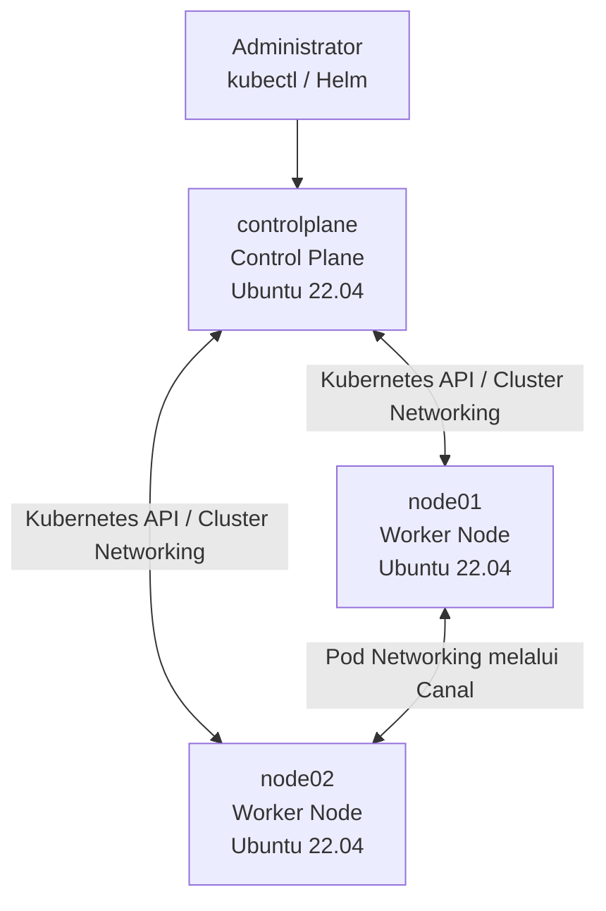

Kubernetes Production Operations
Implementasi, Administrasi, Troubleshooting, Backup & Recovery, serta
Monitoring pada Kubernetes Multi-Node Cluster

01. Gambaran Umum
Kubernetes Production Operations merupakan proyek implementasi dan
pengujian operasional Kubernetes pada lingkungan cluster multi-node.

Proyek ini mencakup administrasi cluster, networking dan Container
Network Interface (CNI), pengelolaan workload, Services dan Ingress,
persistent storage, troubleshooting, ETCD backup dan recovery, serta
monitoring dan observability.

Implementasi dilakukan menggunakan KodeKloud Kubernetes Playground
dengan tiga node, yaitu satu control plane dan dua worker node. Tahapan
operasional menggunakan kubectl, Kubernetes manifests, Helm, ETCD
tools, Prometheus, dan Grafana.

Dokumentasi ini menyajikan tujuan setiap tahap, perintah implementasi
dan pengujian, hasil yang diharapkan, hasil aktual yang tersedia, serta
screenshot sebagai bukti pelaksanaan.
Tujuan Proyek
- Memvalidasi kesehatan dan arsitektur Kubernetes cluster.
- Melakukan administrasi cluster dan pemeriksaan komponen control
  plane.
- Memvalidasi jaringan Pod menggunakan CNI Canal.
- Mengimplementasikan dan mengelola workload Kubernetes.
- Mengonfigurasi Service dan Ingress untuk akses aplikasi.
- Mengimplementasikan persistent storage menggunakan PersistentVolume
  (PV) dan PersistentVolumeClaim (PVC).
- Melakukan troubleshooting dan pemulihan workload.
- Melakukan ETCD backup dan validasi offline recovery.
- Mengimplementasikan monitoring menggunakan Prometheus dan Grafana.
- Melakukan validasi akhir cluster.
02. Arsitektur dan Lingkungan
2.1 Topologi Cluster
Lingkungan pengujian menggunakan satu control plane dan dua worker node.
Control plane mengelola state cluster dan komponen control plane,
sedangkan worker node menjalankan workload aplikasi.

2.2 Informasi Infrastruktur
  Komponen            Konfigurasi
  Platform            KodeKloud Kubernetes Playground
Kubernetes          v1.37.0
Sistem Operasi      Ubuntu 22.04 LTS
Container Runtime   containerd
Control Plane       controlplane
Worker Node 1       node01
Worker Node 2       node02
CNI                 Canal (Calico + Flannel)
DNS                 CoreDNS
Repository          GitHub
2.3 Alur Implementasi
GitHub Repository
        |
        v
Kubernetes Cluster
        |
        v
Cluster Administration
        |
        v
Networking & CNI
        |
        v
Workload Management
        |
        v
Services & Ingress
        |
        v
Persistent Storage
        |
        v
Troubleshooting
        |
        v
ETCD Backup & Recovery
        |
        v
Monitoring & Observability
        |
        v
Final Validation
2.4 Dokumentasi Arsitektur
Gambar 01 --- Arsitektur Kubernetes Multi-Node

Diagram ini menggambarkan susunan cluster yang digunakan selama
implementasi, yaitu satu control plane (controlplane) dan dua worker
node (node01 dan node02).

1.  Repository Proyek
GitHub Repository:
RichardAkbar/kubernetes-production-operations
Struktur Repository
kubernetes-production-operations/
├── architecture/
├── backup-recovery/
├── manifests/
│   └── workloads/
├── monitoring/
├── networking/
├── operations/
├── services/
├── storage/
├── workloads/
├── monitoring-values.yaml
└── README.md

Verifikasi Repository
Repository berhasil di-clone dan diverifikasi.
git clone https://github.com/RichardAkbar/kubernetes-production-operations.git
cd kubernetes-production-operations

git status
git log -1 --oneline

Proses clone merupakan tahap persiapan repository sehingga tidak
memerlukan screenshot bukti pengujian tersendiri.

1.  Implementasi dan Pengujian
Implementasi dibagi menjadi sepuluh tahap operasional. Setiap tahap
memuat tujuan, perintah, hasil yang diharapkan, hasil aktual, dan bukti
screenshot jika tersedia.
Tahap 01 --- Validasi Kubernetes Cluster
Tujuan

Memastikan Kubernetes cluster berjalan normal, seluruh node berstatus
Ready, komponen sistem aktif, dan API Server siap menerima request.
1.1 Memeriksa Informasi Cluster
kubectl cluster-info
Hasil yang diharapkan:
- Kubernetes control plane dapat diakses.
- CoreDNS service tersedia.
Hasil aktual:
- Kubernetes control plane berjalan pada https://controlplane:6443.
- CoreDNS service tersedia.
1.2 Memeriksa Node Kubernetes
kubectl get nodes -o wide
Hasil yang diharapkan:
- Terdapat tiga node.
- Seluruh node berstatus Ready.
- Control plane dan worker node dapat diidentifikasi.
Hasil aktual:

  Node             Role            Status   Versi
  controlplane   control-plane   Ready    v1.37.0
node01         Worker          Ready    v1.37.0
node02         Worker          Ready    v1.37.0
1.3 Memeriksa System Pods
kubectl get pods -n kube-system -o wide
Hasil yang diharapkan:
- ETCD berstatus Running.
- API Server berstatus Running.
- Controller Manager berstatus Running.
- Scheduler berstatus Running.
- CoreDNS berstatus Running.
- Canal dan Kube-proxy berjalan pada setiap node.
Hasil aktual:

  Komponen             Hasil
  ETCD                 1/1 Running
API Server           1/1 Running
Controller Manager   1/1 Running
Scheduler            1/1 Running
CoreDNS              2/2 Running
Canal                3 Pod, masing-masing 2/2 Running
Kube-proxy           3 Pod, masing-masing 1/1 Running
1.4 Memvalidasi API Server Readiness
kubectl get --raw='/readyz?verbose'
Hasil yang diharapkan:

Pemeriksaan readiness menunjukkan status ok, dan baris terakhir
menunjukkan readyz check passed.

Hasil aktual:

Seluruh pemeriksaan readiness berhasil, termasuk ping, log, ETCD, ETCD
readiness, informer sync, dan berbagai post-start hooks.

<badge color="success">{=html}PASS`</badge>`{=html} Status
Pengujian: PASS

Bukti Screenshot --- 01-kubernetes-cluster.png

Screenshot: Letakkan screenshot yang memperlihatkan hasil kubectl get nodes -o wide, status
Pod pada namespace kube-system, serta output API Server readiness
hingga baris readyz check passed.

Tahap 02 --- Cluster Architecture & Administration
Tujuan

Memeriksa arsitektur Kubernetes, fungsi node, namespace, system
workloads, dan komponen administrasi cluster.
2.1 Memeriksa Node dan Detail Konfigurasi
kubectl get nodes -o wide
kubectl describe nodes
Hasil yang diharapkan:
- Node dan role dapat diidentifikasi.
- Informasi kapasitas CPU, memory, kondisi node, serta label tersedia.
Hasil aktual:
Lengkapi berdasarkan output pengujian aktual.
2.2 Memeriksa Namespace
kubectl get namespaces
Hasil yang diharapkan:

Namespace Kubernetes dapat ditampilkan, termasuk default,
kube-system, kube-public, dan kube-node-lease.

Hasil aktual:
Lengkapi berdasarkan output pengujian aktual.
2.3 Memeriksa Control Plane Components
kubectl get pods -n kube-system

kubectl get pods -n kube-system -l component=kube-apiserver
kubectl get pods -n kube-system -l component=kube-controller-manager
kubectl get pods -n kube-system -l component=kube-scheduler
Hasil yang diharapkan:

Komponen control plane dapat ditemukan dan berjalan normal.

Hasil aktual:
Lengkapi berdasarkan output pengujian aktual.
2.4 Memeriksa Cluster Events dan RBAC
kubectl get events -A --sort-by='.lastTimestamp'
kubectl get serviceaccounts -A
kubectl get clusterroles
Hasil yang diharapkan:

Informasi event, ServiceAccount, dan ClusterRole dapat diperiksa.

Hasil aktual:

memperlihatkan detail node dan konfigurasi
cluster, daftar namespace, komponen control plane, serta resource
administrasi cluster seperti events, ServiceAccount, dan ClusterRole.

Tahap 03 --- Networking & CNI Validation
Tujuan

Memvalidasi komponen CNI Canal, alamat IP Pod, DNS resolution, dan
konektivitas antar-Pod.
3.1 Memeriksa CNI Components
kubectl get pods -n kube-system -o wide
Hasil yang diharapkan:

Canal berjalan pada ketiga node.

Hasil aktual:
Lengkapi berdasarkan output pengujian aktual.
3.2 Memeriksa IP Node dan Pod
kubectl get nodes -o wide
kubectl get pods -A -o wide
Hasil yang diharapkan:

Alamat IP node dan Pod dapat ditampilkan.

Hasil aktual:
Lengkapi berdasarkan output pengujian aktual.
3.3 Membuat Pod untuk Pengujian Jaringan
Buat namespace pengujian:
kubectl create namespace networking-lab
Buat dua Pod BusyBox:
kubectl run network-test-1 \
  --image=busybox:1.36 \
  --restart=Never \
  -n networking-lab \
  --command -- sleep 3600

kubectl run network-test-2 \
  --image=busybox:1.36 \
  --restart=Never \
  -n networking-lab \
  --command -- sleep 3600
Periksa status Pod:
kubectl get pods -n networking-lab -o wide
Hasil yang diharapkan:

Kedua Pod berstatus Running dan memperoleh alamat IP.
3.4 Menguji DNS Resolution
kubectl exec -n networking-lab network-test-1 -- \
  nslookup kubernetes.default.svc.cluster.local
Hasil yang diharapkan:

DNS dapat menerjemahkan nama Service Kubernetes ke alamat IP internal.

Hasil aktual:
Lengkapi berdasarkan output pengujian aktual.
3.5 Menguji Konektivitas Antar-Pod
POD2_IP=$(kubectl get pod network-test-2 \
  -n networking-lab -o jsonpath='{.status.podIP}')

kubectl exec -n networking-lab network-test-1 -- \
  ping -c 4 "$POD2_IP"
Hasil yang diharapkan:

Pod pertama dapat menjangkau Pod kedua melalui alamat IP internal.

Hasil aktual:

memperlihatkan status Canal Pod, alamat IP
node dan Pod, hasil DNS resolution, serta output pengujian konektivitas
antar-Pod.

Tahap 04 --- Workload Management
Tujuan

Mengimplementasikan Deployment NGINX, memvalidasi ReplicaSet, health
probes, resource management, dan scaling.
4.1 Membuat Namespace
kubectl create namespace workload-lab
4.2 Melakukan Deployment NGINX
kubectl apply -f manifests/workloads/nginx-deployment.yaml
4.3 Memeriksa Deployment dan ReplicaSet
kubectl get deployments -n workload-lab
kubectl get replicasets -n workload-lab
kubectl get pods -n workload-lab -o wide
Hasil yang diharapkan:
- Deployment berhasil dibuat.
- Lima replika NGINX tersedia.
- Pod berstatus Running dan Ready.
Hasil aktual:
Lengkapi berdasarkan output pengujian aktual.
4.4 Memeriksa Konfigurasi Deployment
kubectl describe deployment nginx-deployment -n workload-lab
Hasil yang diharapkan:

Konfigurasi image, replicas, resource requests, resource limits,
readiness probe, dan liveness probe dapat diperiksa.

Hasil aktual:
Lengkapi berdasarkan output pengujian aktual.
4.5 Melakukan Scaling Workload
Ubah jumlah replika menjadi tiga:
kubectl scale deployment nginx-deployment \
  --replicas=3 -n workload-lab
Validasi hasil scaling:
kubectl get deployment nginx-deployment -n workload-lab
kubectl get pods -n workload-lab
Hasil yang diharapkan:

Jumlah replika berubah menjadi tiga dan Deployment menunjukkan
3/3 Available.

Hasil aktual:
Lengkapi berdasarkan output pengujian aktual.

Status Pengujian: Belum dilengkapi

Bukti Screenshot --- 04-workload-management.png

Screenshot: Letakkan screenshot yang memperlihatkan Deployment NGINX, ReplicaSet,
Pod yang berjalan, serta hasil perubahan jumlah replika setelah proses
scaling.

Tahap 05 --- Services & Ingress
Tujuan

Mengimplementasikan Service untuk mengekspos aplikasi NGINX dan
memvalidasi mekanisme routing trafik.
5.1 Membuat Namespace
kubectl create namespace services-lab
5.2 Memastikan Workload Memiliki Label yang Sesuai
Periksa selector dan label Deployment sebelum membuat Service:
kubectl get pods -n services-lab --show-labels
Catatan konfigurasi:

Manifest Service yang tersedia menggunakan selector app: nginx-app,
sedangkan manifest Deployment awal menggunakan label app: nginx.
Keduanya perlu diselaraskan sebelum pengujian agar Service dapat
menemukan Pod yang sesuai.
5.3 Mengimplementasikan Service
kubectl apply -f services/nginx-services.yaml
5.4 Memeriksa Service dan Endpoint
kubectl get services -n services-lab
kubectl get endpoints -n services-lab
kubectl get endpointslices -n services-lab
Hasil yang diharapkan:
- ClusterIP tersedia.
- NodePort tersedia.
- Endpoint mengarah ke Pod aplikasi yang benar.
- LoadBalancer diuji sesuai dukungan environment.
Hasil aktual:
Lengkapi berdasarkan output pengujian aktual.
5.5 Memvalidasi Ingress
Periksa IngressClass dan Ingress Controller:
kubectl get ingressclass
kubectl get pods -A | grep -i ingress
Jika Ingress Controller tersedia, terapkan manifest:
kubectl apply -f services/nginx-ingress.yaml

kubectl get ingress -n services-lab
kubectl describe ingress nginx-ingress -n services-lab
Uji HTTP routing menggunakan hostname dan alamat yang sesuai dengan
konfigurasi Ingress aktual:
# Ganti hostname sesuai konfigurasi Ingress yang digunakan.
curl -I -H "Host: <INGRESS_HOSTNAME>" http://<INGRESS_ADDRESS>
Hasil yang diharapkan:

Request HTTP diarahkan ke Service dan aplikasi NGINX yang benar.

Hasil aktual:

memperlihatkan Service ClusterIP dan
NodePort, Endpoint atau EndpointSlice, serta konfigurasi Ingress dan
hasil HTTP routing apabila Ingress Controller tersedia pada environment.

Tahap 06 --- Storage Management
Tujuan

Mengimplementasikan persistent storage menggunakan PersistentVolume,
PersistentVolumeClaim, dan Pod yang menggunakan volume tersebut.
6.1 Menyiapkan Direktori Storage
Konfigurasi proyek menggunakan hostPath: /mnt/k8s-storage pada node
controlplane.

Jalankan persiapan pada node yang sesuai:
mkdir -p /mnt/k8s-storage
ls -ld /mnt/k8s-storage
6.2 Membuat Namespace
kubectl create namespace storage-lab
6.3 Membuat PersistentVolume
kubectl apply -f storage/persistent-volume.yaml
kubectl get pv
Hasil yang diharapkan:

PV berhasil dibuat dan berstatus Available sebelum diklaim.
6.4 Membuat PersistentVolumeClaim
kubectl apply -f storage/persistent-volume-claim.yaml

kubectl get pvc -n storage-lab
kubectl get pv
Hasil yang diharapkan:

PVC berhasil terhubung ke PV dan berstatus Bound.
6.5 Membuat Storage Test Pod
kubectl apply -f storage/storage-test-pod.yaml
kubectl get pods -n storage-lab -o wide
6.6 Memvalidasi Mount dan Data Persistence
Tulis data ke volume:
kubectl exec -n storage-lab storage-test -- \
  sh -c 'echo "Kubernetes persistent storage test" > /data/test.txt'
Periksa data:
kubectl exec -n storage-lab storage-test -- cat /data/test.txt
Hapus dan buat ulang Pod setelah memastikan PVC tetap Bound:
kubectl delete pod storage-test -n storage-lab
kubectl apply -f storage/storage-test-pod.yaml
Periksa kembali Pod dan data:
kubectl get pods -n storage-lab

kubectl exec -n storage-lab storage-test -- \
  cat /data/test.txt
Hasil yang diharapkan:

Data masih dapat dibaca setelah Pod dibuat ulang, selama hostPath dan
node yang digunakan tetap sama.

Hasil aktual:
Lengkapi berdasarkan output pengujian aktual.

Catatan: hostPath terikat pada filesystem node tertentu. Pengujian
persistence perlu memastikan Pod kembali menggunakan node yang sama agar
hasilnya sesuai dengan skenario penyimpanan ini.

memperlihatkan status PV, PVC Bound,
Storage Test Pod yang berjalan, serta hasil pembacaan data setelah Pod
dihapus dan dibuat ulang.

Tahap 07 --- Production Troubleshooting
Tujuan

Menguji kemampuan troubleshooting terhadap Pod yang bermasalah
menggunakan logs, describe, dan events.
7.1 Membuat Namespace
kubectl create namespace troubleshooting-lab
7.2 Mengimplementasikan Pod
kubectl apply -f operations/broken-pod.yaml
7.3 Memeriksa Status Pod
kubectl get pods -n troubleshooting-lab -o wide
7.4 Memeriksa Detail Pod
kubectl describe pod broken-nginx -n troubleshooting-lab
7.5 Memeriksa Logs
kubectl logs broken-nginx -n troubleshooting-lab
7.6 Memeriksa Events
kubectl get events -n troubleshooting-lab \
  --sort-by='.lastTimestamp'
7.7 Menguji CrashLoopBackOff
Gunakan manifest CrashLoopBackOff yang telah disiapkan dan diverifikasi
agar container berhenti dengan exit code bukan nol.
kubectl apply -f operations/crashloop-pod.yaml
kubectl get pods -n troubleshooting-lab -w
Periksa penyebab kegagalan:
kubectl describe pod crashloop-demo -n troubleshooting-lab
kubectl logs crashloop-demo -n troubleshooting-lab
7.8 Melakukan Recovery
Setelah penyebab ditemukan dan konfigurasi diperbaiki, terapkan
konfigurasi yang telah diperbaiki dan verifikasi:
kubectl delete pod crashloop-demo -n troubleshooting-lab

# Terapkan manifest hasil perbaikan sesuai file yang digunakan.
kubectl apply -f operations/crashloop-pod.yaml

kubectl get pods -n troubleshooting-lab
Hasil yang diharapkan:
- Penyebab kegagalan dapat diidentifikasi.
- Logs dan events memberikan informasi untuk troubleshooting.
- Workload dapat dipulihkan setelah konfigurasi diperbaiki.
Hasil aktual:
Lengkapi berdasarkan output pengujian aktual.

Status Pengujian: Belum dilengkapi

Bukti Screenshot --- 07-production-operations.png

Screenshot: Letakkan screenshot yang memperlihatkan kondisi Pod bermasalah, output
describe, logs dan events yang digunakan untuk investigasi, serta
status Pod setelah recovery.

Tahap 08 --- ETCD Backup & Recovery
Tujuan

Melakukan pemeriksaan kesehatan ETCD, pembuatan snapshot, verifikasi
checksum, dan validasi offline restore pada direktori terpisah.
8.1 Memeriksa ETCD Pod
kubectl get pods -n kube-system | grep etcd
8.2 Memeriksa ETCD Configuration
Periksa static Pod manifest:
cat /etc/kubernetes/manifests/etcd.yaml
Identifikasi konfigurasi aktual berikut:
- ETCD endpoint.
- Lokasi etcdctl.
- Lokasi etcdutl.
- Certificate dan key.
- Lokasi data directory.
8.3 Memvalidasi ETCD Health
Gunakan endpoint dan certificate berdasarkan konfigurasi aktual. Contoh
berikut menggunakan placeholder yang harus diganti:
ETCDCTL_API=3 etcdctl \
  --endpoints=https://127.0.0.1:2379 \
  --cacert=<CA_CERT_PATH> \
  --cert=<SERVER_CERT_PATH> \
  --key=<SERVER_KEY_PATH> \
  endpoint health
8.4 Membuat Snapshot
ETCDCTL_API=3 etcdctl \
  --endpoints=https://127.0.0.1:2379 \
  --cacert=<CA_CERT_PATH> \
  --cert=<SERVER_CERT_PATH> \
  --key=<SERVER_KEY_PATH> \
  snapshot save /tmp/etcd-snapshot.db
8.5 Memeriksa Snapshot
ls -lh /tmp/etcd-snapshot.db
sha256sum /tmp/etcd-snapshot.db
8.6 Memeriksa Snapshot Status
Gunakan etcdutl atau tool yang tersedia pada environment:
etcdutl snapshot status /tmp/etcd-snapshot.db -w table
8.7 Melakukan Offline Restore
Restore dilakukan ke direktori terpisah dan tidak boleh menimpa data
directory ETCD aktif.
etcdutl snapshot restore /tmp/etcd-snapshot.db \
  --data-dir=/tmp/etcd-restore-lab
Periksa hasil restore:
du -sh /tmp/etcd-restore-lab
Hasil yang diharapkan:
- ETCD health berhasil.
- Snapshot berhasil dibuat.
- Checksum berhasil dihitung.
- Metadata snapshot dapat dibaca.
- Offline restore berhasil pada direktori terpisah.
- ETCD aktif tidak terganggu.
Hasil aktual:
Lengkapi berdasarkan output pengujian aktual.

Status Pengujian: Belum dilengkapi

Bukti Screenshot --- 08-etcd-backup-recovery.png

Screenshot: Letakkan screenshot yang memperlihatkan hasil ETCD health check,
proses pembuatan snapshot, snapshot status, checksum, dan keberhasilan
offline restore pada direktori terpisah.

Catatan keamanan: Snapshot ETCD mengandung data sensitif cluster.
Jangan mengunggah file snapshot, certificate, private key, atau
credential ke repository publik.

Tahap 09 --- Monitoring & Observability
Tujuan

Mengimplementasikan Prometheus dan Grafana untuk memantau kondisi dan
metrics Kubernetes cluster.
9.1 Menambahkan Helm Repository
helm repo add prometheus-community \
  https://prometheus-community.github.io/helm-charts

helm repo update
9.2 Membuat Namespace Monitoring
kubectl create namespace monitoring
9.3 Memeriksa Konfigurasi Monitoring
cat monitoring-values.yaml
9.4 Menginstal Monitoring Stack
helm install monitoring prometheus-community/kube-prometheus-stack \
  --namespace monitoring \
  --version 93.2.2 \
  -f monitoring-values.yaml
9.5 Memeriksa Monitoring Components
kubectl get pods -n monitoring
kubectl get services -n monitoring
9.6 Mengakses Prometheus
Periksa nama Service Prometheus:
kubectl get services -n monitoring
Gunakan nama Service aktual untuk port-forward:
kubectl port-forward -n monitoring \
  svc/<PROMETHEUS_SERVICE> 9090:9090
Akses Prometheus melalui browser:

http://localhost:9090
9.7 Memvalidasi Prometheus Targets
Jalankan query PromQL berikut pada antarmuka Prometheus:
up
count(up == 1)
count(up == 0)
Hasil yang diharapkan:

Target monitoring dapat dilihat beserta status UP atau DOWN. Target
yang DOWN perlu dianalisis berdasarkan kondisi environment.
9.8 Mengakses Grafana
Periksa nama Service Grafana:
kubectl get services -n monitoring
Gunakan nama Service aktual untuk port-forward:
kubectl port-forward -n monitoring \
  svc/<GRAFANA_SERVICE> 3000:80
Akses Grafana:

http://localhost:3000
9.9 Memvalidasi Dashboard
Periksa visualisasi berikut:
- CPU Usage.
- Memory Usage.
- Pod dan Namespace Metrics.
- Kubernetes Cluster Overview.
- Prometheus Targets.
Hasil aktual:
Lengkapi berdasarkan hasil Prometheus dan Grafana yang benar-benar diperoleh.

Status Pengujian: Belum dilengkapi

Bukti Screenshot --- 09-monitoring-observability.png

Screenshot: Letakkan screenshot yang memperlihatkan Pod monitoring, Prometheus
Targets, contoh query PromQL, dan dashboard Grafana yang menampilkan
metrics Kubernetes.

Tahap 10 --- Final Validation
Tujuan

Melakukan pemeriksaan akhir untuk memastikan cluster dan seluruh
resource pengujian berada dalam kondisi yang sesuai.
10.1 Memeriksa Node
kubectl get nodes -o wide
10.2 Memeriksa Namespace
kubectl get namespaces
10.3 Memeriksa Seluruh Pod
kubectl get pods -A -o wide
10.4 Memeriksa Deployment dan Service
kubectl get deployments -A
kubectl get services -A
kubectl get ingress -A
10.5 Memeriksa Storage
kubectl get pv
kubectl get pvc -A
10.6 Memvalidasi API Readiness
kubectl get --raw='/readyz?verbose'
Hasil yang diharapkan:
- Node tetap berstatus Ready.
- Resource pengujian berada pada status sesuai skenario.
- Workload dan monitoring berjalan sesuai implementasi.
- API Server tetap Ready.
Hasil aktual:
Lengkapi berdasarkan output pengujian aktual.

Status Pengujian: Belum dilengkapi

Bukti Screenshot --- 10-final-validation.png

Screenshot: Letakkan screenshot yang memperlihatkan pemeriksaan akhir node,
namespace, Pod, Deployment, Service, Ingress, PV, PVC, serta API Server
readiness.

05. Ringkasan Bukti Pengujian
Tabel berikut merangkum sepuluh screenshot utama yang digunakan untuk
mendokumentasikan tahapan implementasi.
                No. Tahapan           Nama Screenshot                                Status
                                                                                     berdasarkan
                                                                                     dokumentasi

                 01 Cluster           `01-kubernetes-cluster.png`                    PASS
                    Validation                                                       

                 02 Architecture &    `02-cluster-architecture-administration.png`   Belum diuji
                    Administration                                                   

                 03 Networking & CNI  `03-networking-cni.png`                        Belum diuji

                 04 Workload          `04-workload-management.png`                   Belum diuji
                    Management                                                       

                 05 Services &        `05-services-ingress.png`                      Belum diuji
                    Ingress                                                          

                 06 Storage           `06-storage-management.png`                    Belum diuji
                    Management                                                       

                 07 Production        `07-production-operations.png`                 Belum diuji
                    Troubleshooting                                                  

                 08 ETCD Backup &     `08-etcd-backup-recovery.png`                  Belum diuji
                    Recovery                                                         

                 09 Monitoring &      `09-monitoring-observability.png`              Belum diuji
                    Observability                                                    

                 10 Final Validation  `10-final-validation.png`                      Belum diuji

Status di atas mengikuti informasi yang tersedia pada dokumentasi
sumber. Perbarui status setelah setiap tahap benar-benar diuji dan
bukti screenshot tersedia.

06. Kesimpulan
Kubernetes Production Operations dirancang sebagai implementasi praktis
operasional Kubernetes pada cluster multi-node, mulai dari validasi
kesehatan cluster hingga administrasi, networking, workload management,
Services dan Ingress, persistent storage, troubleshooting, ETCD backup
dan recovery, serta monitoring.

Proyek ini memberikan pengalaman dalam menjalankan pemeriksaan dan
operasi Kubernetes menggunakan kubectl, Kubernetes manifests, Helm,
ETCD tools, Prometheus, dan Grafana.

Kesimpulan akhir mengenai keberhasilan seluruh implementasi harus
didasarkan pada hasil aktual setiap tahap dan bukti pengujian yang
tersedia. Tahap yang belum diuji atau tidak didukung oleh environment
perlu dicatat sebagai PARTIAL atau NOT TESTED, bukan dinyatakan
berhasil.
07. Informasi Repository
GitHub Repository:
https://github.com/RichardAkbar/kubernetes-production-operations

Penyusun: Richard Jabar Akbar

Platform: KodeKloud Kubernetes Playground

Status Dokumentasi: Dalam proses validasi dan pelengkapan hasil
pengujian.