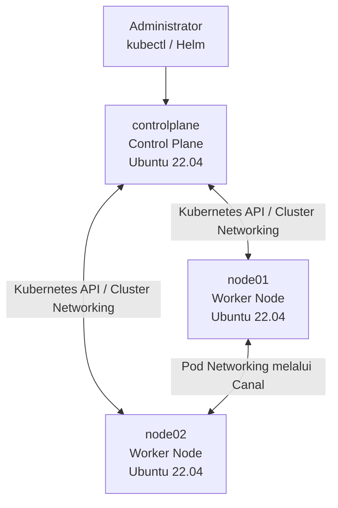
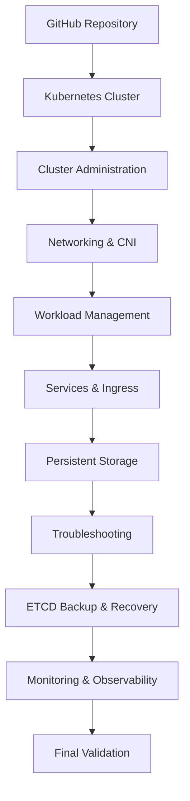
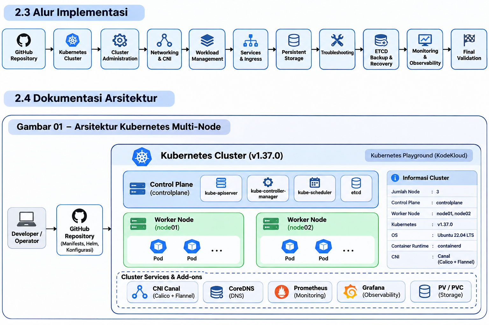
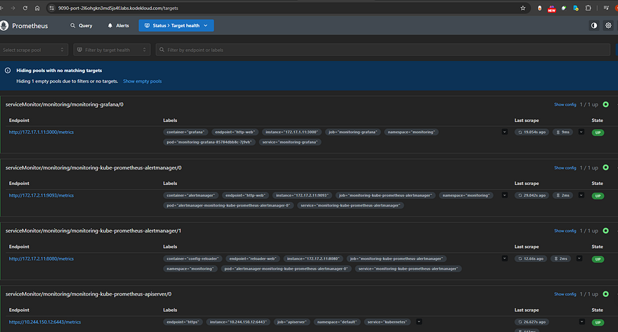
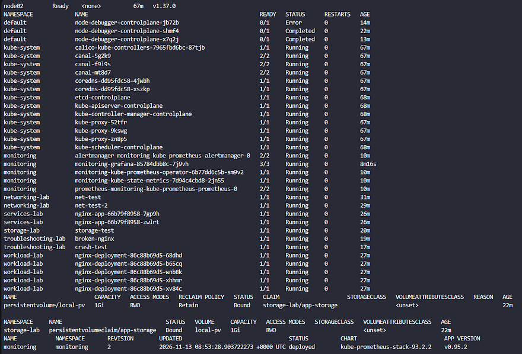

# Kubernetes Production Operations

**Implementasi, Administrasi, Troubleshooting, Backup & Recovery, serta
Monitoring pada Kubernetes Multi-Node Cluster**

[](https://kubernetes.io/)
[](https://ubuntu.com/)
[](https://containerd.io/)
[](https://prometheus.io/)
[](https://kodekloud.com/)
[]()

------------------------------------------------------------------------

## 01. Gambaran Umum Proyek

**Kubernetes Production Operations** merupakan proyek implementasi dan
pengujian operasional Kubernetes pada lingkungan cluster multi-node.

Proyek ini menerapkan praktik administrasi dan operasional Kubernetes
yang mencakup cluster administration, networking dan Container Network
Interface (CNI), workload management, Services dan Ingress, persistent
storage, troubleshooting, ETCD backup dan recovery, serta monitoring dan
observability.

Implementasi dilakukan menggunakan KodeKloud Kubernetes Playground
dengan tiga node, yaitu satu control plane dan dua worker node.
Aktivitas operasional menggunakan `kubectl`, Kubernetes manifests, Helm,
ETCD tools, Prometheus, dan Grafana.

Dokumentasi ini menyajikan tujuan setiap tahap, perintah implementasi
dan pengujian, hasil yang diharapkan, hasil aktual yang tersedia, serta
screenshot sebagai bukti pelaksanaan.

### Tujuan Proyek

-   Memvalidasi kesehatan dan arsitektur Kubernetes cluster.
-   Melakukan administrasi cluster dan pemeriksaan komponen control
    plane.
-   Memvalidasi jaringan Pod menggunakan CNI Canal.
-   Mengimplementasikan dan mengelola workload Kubernetes.
-   Mengonfigurasi Service dan Ingress untuk akses aplikasi.
-   Mengimplementasikan persistent storage menggunakan PersistentVolume
    (PV) dan PersistentVolumeClaim (PVC).
-   Melakukan troubleshooting dan pemulihan workload.
-   Melakukan ETCD backup dan validasi offline recovery.
-   Mengimplementasikan monitoring menggunakan Prometheus dan Grafana.
-   Melakukan validasi akhir cluster.

### Teknologi yang Digunakan

  Kategori                  Teknologi
  ------------------------- -----------------------------------
  Container Orchestration   Kubernetes v1.37.0
  Platform                  KodeKloud Kubernetes Playground
  Operating System          Ubuntu 22.04 LTS
  Container Runtime         containerd
  Networking / CNI          Canal (Calico + Flannel)
  Cluster DNS               CoreDNS
  Package Management        Helm
  Backup & Recovery         ETCD tools (`etcdctl`, `etcdutl`)
  Monitoring                Prometheus
  Visualization             Grafana
  Configuration             Kubernetes YAML Manifests
  Version Control           Git
  Repository                GitHub

------------------------------------------------------------------------

## 02. Arsitektur Infrastruktur

### 2.1 Topologi Cluster

Lingkungan pengujian menggunakan satu control plane dan dua worker node.
Control plane bertanggung jawab mengelola state cluster dan komponen
control plane, sedangkan worker node menjalankan workload aplikasi.



### 2.2 Komponen Infrastruktur

  -----------------------------------------------------------------------
  Komponen                Fungsi                  Konfigurasi
  ----------------------- ----------------------- -----------------------
  controlplane            Mengelola control plane Ubuntu 22.04
                          dan state cluster       

  node01                  Menjalankan workload    Ubuntu 22.04
                          aplikasi                

  node02                  Menjalankan workload    Ubuntu 22.04
                          aplikasi                

  containerd              Menjalankan container   Container Runtime
                          workload                

  Canal                   Menyediakan jaringan    Calico + Flannel
                          Pod                     

  CoreDNS                 Menyediakan DNS         Kubernetes DNS
                          internal cluster        
  -----------------------------------------------------------------------

### 2.3 Informasi Lingkungan

  Komponen            Konfigurasi
  ------------------- ---------------------------------
  Platform            KodeKloud Kubernetes Playground
  Kubernetes          v1.37.0
  Sistem Operasi      Ubuntu 22.04 LTS
  Container Runtime   containerd
  Control Plane       controlplane
  Worker Node 1       node01
  Worker Node 2       node02
  CNI                 Canal (Calico + Flannel)
  DNS                 CoreDNS

### 2.4 Alur Implementasi



### 2.5 Dokumentasi Arsitektur

**Gambar 01 -- Kubernetes Multi-Node Cluster Architecture**

Diagram berikut memperlihatkan susunan cluster yang digunakan selama
implementasi, yaitu satu control plane (`controlplane`) dan dua worker
node (`node01` dan `node02`).



------------------------------------------------------------------------

## 03. Implementasi Proyek

Implementasi dibagi menjadi sepuluh tahap operasional. Setiap tahap
memuat tujuan, perintah implementasi, hasil validasi, dan dokumentasi
screenshot. Hasil aktual hanya dinyatakan berhasil apabila didukung oleh
output pengujian yang tersedia.

### 3.1 Kubernetes Cluster Validation

**Tujuan:** Memastikan Kubernetes cluster berjalan normal, seluruh node
berstatus `Ready`, komponen sistem aktif, dan API Server siap menerima
request.

**Implementasi:**

Memeriksa informasi cluster:

``` bash
kubectl cluster-info
```

Memeriksa node Kubernetes:

``` bash
kubectl get nodes -o wide
```

Memeriksa system Pods:

``` bash
kubectl get pods -n kube-system -o wide
```

Memvalidasi API Server readiness:

``` bash
kubectl get --raw='/readyz?verbose'
```

**Hasil Validasi:**

Hasil aktual yang tersedia menunjukkan:

-   Kubernetes control plane dapat diakses melalui
    `https://controlplane:6443`.
-   Terdapat tiga node: `controlplane`, `node01`, dan `node02`.
-   Seluruh node berstatus `Ready` dan menggunakan Kubernetes `v1.37.0`.
-   ETCD, API Server, Controller Manager, dan Scheduler berstatus
    `Running`.
-   CoreDNS berjalan dengan status `2/2 Running`.
-   Canal berjalan pada tiga node, masing-masing `2/2 Running`.
-   Kube-proxy berjalan pada tiga node, masing-masing `1/1 Running`.
-   Pemeriksaan API Server readiness berhasil dan menampilkan
    `readyz check passed`.

  Komponen               Hasil Aktual
  ---------------------- ----------------------------------
  controlplane           Ready
  node01                 Ready
  node02                 Ready
  ETCD                   1/1 Running
  API Server             1/1 Running
  Controller Manager     1/1 Running
  Scheduler              1/1 Running
  CoreDNS                2/2 Running
  Canal                  3 Pod, masing-masing 2/2 Running
  Kube-proxy             3 Pod, masing-masing 1/1 Running
  API Server Readiness   PASS

`<sub>`{=html}Project test status: PASS untuk validasi cluster yang
tercantum di atas.`</sub>`{=html}

------------------------------------------------------------------------

### 3.2 Cluster Architecture & Administration

**Tujuan:** Memeriksa arsitektur Kubernetes, fungsi node, namespace,
system workloads, dan komponen administrasi cluster.

**Implementasi:**

Memeriksa node dan detail konfigurasi:

``` bash
kubectl get nodes -o wide
kubectl describe nodes
```

Memeriksa namespace:

``` bash
kubectl get namespaces
```

Memeriksa control plane components:

``` bash
kubectl get pods -n kube-system
kubectl get pods -n kube-system -l component=kube-apiserver
kubectl get pods -n kube-system -l component=kube-controller-manager
kubectl get pods -n kube-system -l component=kube-scheduler
```

Memeriksa cluster events dan RBAC:

``` bash
kubectl get events -A --sort-by='.lastTimestamp'
kubectl get serviceaccounts -A
kubectl get clusterroles
```

**Hasil Validasi:**

-   Informasi node, role, kapasitas CPU dan memory, kondisi node, serta
    label dapat diperiksa.
-   Namespace Kubernetes dapat ditampilkan, termasuk namespace sistem.
-   Komponen control plane dapat diperiksa melalui Pod dan label
    komponennya.
-   Informasi events, ServiceAccount, dan ClusterRole dapat diperiksa.

**Hasil aktual:** Lengkapi berdasarkan output pengujian aktual.
Screenshot yang tersedia memperlihatkan pemeriksaan arsitektur dan
administrasi cluster, tetapi output rinci setiap perintah belum
dicantumkan dalam dokumentasi sumber.

**Dokumentasi Screenshot -- Cluster Architecture & Administration**

Gambar berikut memperlihatkan detail node dan konfigurasi cluster,
daftar namespace, komponen control plane, serta resource administrasi
cluster seperti events, ServiceAccount, dan ClusterRole.


------------------------------------------------------------------------

### 3.3 Kubernetes Networking & CNI Validation

**Tujuan:** Memvalidasi komponen CNI Canal, alamat IP Pod, DNS
resolution, dan konektivitas antar-Pod.

**Implementasi:**

Memeriksa CNI components:

``` bash
kubectl get pods -n kube-system -o wide
```

Memeriksa IP node dan Pod:

``` bash
kubectl get nodes -o wide
kubectl get pods -A -o wide
```

Membuat namespace pengujian:

``` bash
kubectl create namespace networking-lab
```

Membuat dua Pod BusyBox:

``` bash
kubectl run network-test-1 \
  --image=busybox:1.36 \
  --restart=Never \
  -n networking-lab \
  --command -- sleep 3600

kubectl run network-test-2 \
  --image=busybox:1.36 \
  --restart=Never \
  -n networking-lab \
  --command -- sleep 3600
```

Memeriksa status Pod:

``` bash
kubectl get pods -n networking-lab -o wide
```

Menguji DNS resolution:

``` bash
kubectl exec -n networking-lab network-test-1 -- \
  nslookup kubernetes.default.svc.cluster.local
```

Menguji konektivitas antar-Pod:

``` bash
POD2_IP=$(kubectl get pod network-test-2 \
  -n networking-lab -o jsonpath='{.status.podIP}')

kubectl exec -n networking-lab network-test-1 -- \
  ping -c 4 "$POD2_IP"
```

**Hasil Validasi:**

-   Canal diharapkan berjalan pada ketiga node.
-   Alamat IP node dan Pod dapat ditampilkan.
-   Kedua Pod BusyBox diharapkan berstatus `Running` dan memperoleh
    alamat IP.
-   DNS diharapkan dapat menerjemahkan nama Service Kubernetes.
-   Pod pertama diharapkan dapat menjangkau Pod kedua melalui alamat IP
    internal.

**Hasil aktual:** Lengkapi berdasarkan output pengujian aktual untuk
status Pod pengujian, DNS resolution, dan konektivitas antar-Pod.

**Dokumentasi Screenshot -- Networking & CNI Validation**

Gambar berikut memperlihatkan status Canal Pod, alamat IP node dan Pod,
hasil DNS resolution, serta output pengujian konektivitas antar-Pod.


------------------------------------------------------------------------

### 3.4 Kubernetes Workload Management

**Tujuan:** Mengimplementasikan Deployment NGINX, memvalidasi
ReplicaSet, health probes, resource management, dan scaling.

**Implementasi:**

Membuat namespace:

``` bash
kubectl create namespace workload-lab
```

Melakukan deployment NGINX:

``` bash
kubectl apply -f manifests/workloads/nginx-deployment.yaml
```

Memeriksa Deployment, ReplicaSet, dan Pod:

``` bash
kubectl get deployments -n workload-lab
kubectl get replicasets -n workload-lab
kubectl get pods -n workload-lab -o wide
```

Memeriksa konfigurasi Deployment:

``` bash
kubectl describe deployment nginx-deployment -n workload-lab
```

Melakukan scaling menjadi tiga replika:

``` bash
kubectl scale deployment nginx-deployment \
  --replicas=3 -n workload-lab
```

Memvalidasi hasil scaling:

``` bash
kubectl get deployment nginx-deployment -n workload-lab
kubectl get pods -n workload-lab
```

**Hasil Validasi:**

-   Deployment NGINX diharapkan berhasil dibuat.
-   Konfigurasi awal menargetkan lima replika.
-   Pod diharapkan berstatus `Running` dan `Ready`.
-   Image, resource requests, resource limits, readiness probe, dan
    liveness probe dapat diperiksa.
-   Setelah scaling, jumlah replika ditargetkan menjadi tiga dan
    Deployment menunjukkan `3/3 Available`.

**Hasil aktual:** Belum dilengkapi pada dokumentasi sumber. Lengkapi
berdasarkan output Deployment, ReplicaSet, Pod, dan hasil scaling.

**Dokumentasi Screenshot -- Workload Management**

Gambar berikut memperlihatkan Deployment NGINX, ReplicaSet, Pod yang
berjalan, serta hasil perubahan jumlah replika setelah proses scaling.


------------------------------------------------------------------------

### 3.5 Kubernetes Services & Ingress

**Tujuan:** Mengimplementasikan Service untuk mengekspos aplikasi NGINX
dan memvalidasi mekanisme routing trafik.

**Implementasi:**

Membuat namespace:

``` bash
kubectl create namespace services-lab
```

Memeriksa label Pod:

``` bash
kubectl get pods -n services-lab --show-labels
```

Mengimplementasikan Service:

``` bash
kubectl apply -f services/nginx-services.yaml
```

Memeriksa Service dan endpoint:

``` bash
kubectl get services -n services-lab
kubectl get endpoints -n services-lab
kubectl get endpointslices -n services-lab
```

Memeriksa IngressClass dan Ingress Controller:

``` bash
kubectl get ingressclass
kubectl get pods -A | grep -i ingress
```

Jika Ingress Controller tersedia, terapkan manifest dan periksa
hasilnya:

``` bash
kubectl apply -f services/nginx-ingress.yaml
kubectl get ingress -n services-lab
kubectl describe ingress nginx-ingress -n services-lab
```

Uji HTTP routing menggunakan hostname dan alamat yang sesuai dengan
konfigurasi aktual:

``` bash
curl -I -H "Host: <INGRESS_HOSTNAME>" http://<INGRESS_ADDRESS>
```

**Catatan Konfigurasi:**

Manifest Service yang tersedia menggunakan selector `app: nginx-app`,
sedangkan manifest Deployment awal menggunakan label `app: nginx`.
Keduanya perlu diselaraskan sebelum pengujian agar Service dapat
menemukan Pod yang sesuai.

Ingress Controller juga harus tersedia pada environment sebelum
pengujian routing Ingress dilakukan.

**Hasil Validasi:**

-   ClusterIP dan NodePort diharapkan tersedia sesuai manifest.
-   Endpoint atau EndpointSlice diharapkan mengarah ke Pod aplikasi yang
    benar.
-   LoadBalancer diuji sesuai dukungan environment.
-   Request HTTP diharapkan diarahkan ke Service dan aplikasi NGINX yang
    benar apabila Ingress Controller tersedia.

**Hasil aktual:** Lengkapi berdasarkan output Service, Endpoint,
EndpointSlice, Ingress, dan pengujian HTTP. Jangan menyatakan Ingress
berhasil apabila Ingress Controller belum tersedia.

**Dokumentasi Screenshot -- Services & Ingress**

Gambar berikut memperlihatkan Service ClusterIP dan NodePort, Endpoint
atau EndpointSlice, serta konfigurasi Ingress dan hasil HTTP routing
apabila Ingress Controller tersedia pada environment.


------------------------------------------------------------------------

### 3.6 Kubernetes Persistent Storage Management

**Tujuan:** Mengimplementasikan persistent storage menggunakan
PersistentVolume, PersistentVolumeClaim, dan Pod yang menggunakan volume
tersebut.

**Implementasi:**

Menyiapkan direktori storage pada node yang sesuai. Konfigurasi proyek
menggunakan `hostPath: /mnt/k8s-storage` pada node `controlplane`.

``` bash
mkdir -p /mnt/k8s-storage
ls -ld /mnt/k8s-storage
```

Membuat namespace:

``` bash
kubectl create namespace storage-lab
```

Membuat PersistentVolume:

``` bash
kubectl apply -f storage/persistent-volume.yaml
kubectl get pv
```

Membuat PersistentVolumeClaim:

``` bash
kubectl apply -f storage/persistent-volume-claim.yaml
kubectl get pvc -n storage-lab
kubectl get pv
```

Membuat Storage Test Pod:

``` bash
kubectl apply -f storage/storage-test-pod.yaml
kubectl get pods -n storage-lab -o wide
```

Menulis dan membaca data pada volume:

``` bash
kubectl exec -n storage-lab storage-test -- \
  sh -c 'echo "Kubernetes persistent storage test" > /data/test.txt'

kubectl exec -n storage-lab storage-test -- cat /data/test.txt
```

Menghapus dan membuat ulang Pod:

``` bash
kubectl delete pod storage-test -n storage-lab
kubectl apply -f storage/storage-test-pod.yaml

kubectl get pods -n storage-lab

kubectl exec -n storage-lab storage-test -- \
  cat /data/test.txt
```

**Hasil Validasi:**

-   PV diharapkan berhasil dibuat dan berstatus `Available` sebelum
    diklaim.
-   PVC diharapkan terhubung ke PV dan berstatus `Bound`.
-   Storage Test Pod diharapkan berhasil melakukan mount volume.
-   Data diharapkan tetap dapat dibaca setelah Pod dibuat ulang, selama
    hostPath dan node yang digunakan tetap sama.

**Catatan Storage:**

`hostPath` terikat pada filesystem node tertentu. Pengujian persistence
perlu memastikan Pod kembali menggunakan node yang sama agar hasilnya
sesuai dengan skenario penyimpanan ini. Penggunaan `hostPath` pada
proyek ini merupakan skenario lab dan bukan pengganti solusi persistent
storage terdistribusi untuk lingkungan production.

**Hasil aktual:** Lengkapi berdasarkan output PV, PVC, status Pod, dan
pembacaan data setelah Pod dibuat ulang.

**Dokumentasi Screenshot -- Persistent Storage Management**

Gambar berikut memperlihatkan status PV, PVC `Bound`, Storage Test Pod
yang berjalan, serta hasil pembacaan data setelah Pod dihapus dan dibuat
ulang.


------------------------------------------------------------------------

### 3.7 Production Troubleshooting

**Tujuan:** Menguji kemampuan troubleshooting terhadap Pod yang
bermasalah menggunakan logs, describe, dan events.

**Implementasi:**

Membuat namespace:

``` bash
kubectl create namespace troubleshooting-lab
```

Menerapkan Pod bermasalah:

``` bash
kubectl apply -f operations/broken-pod.yaml
```

Memeriksa status dan detail Pod:

``` bash
kubectl get pods -n troubleshooting-lab -o wide
kubectl describe pod broken-nginx -n troubleshooting-lab
```

Memeriksa logs dan events:

``` bash
kubectl logs broken-nginx -n troubleshooting-lab

kubectl get events -n troubleshooting-lab \
  --sort-by='.lastTimestamp'
```

Menguji CrashLoopBackOff:

``` bash
kubectl apply -f operations/crashloop-pod.yaml
kubectl get pods -n troubleshooting-lab -w
```

Memeriksa penyebab kegagalan:

``` bash
kubectl describe pod crashloop-demo -n troubleshooting-lab
kubectl logs crashloop-demo -n troubleshooting-lab
```

Melakukan recovery setelah penyebab ditemukan dan konfigurasi
diperbaiki:

``` bash
kubectl delete pod crashloop-demo -n troubleshooting-lab

# Terapkan manifest hasil perbaikan sesuai file yang digunakan.
kubectl apply -f operations/crashloop-pod.yaml

kubectl get pods -n troubleshooting-lab
```

**Hasil Validasi:**

-   Penyebab kegagalan diharapkan dapat diidentifikasi.
-   Logs dan events diharapkan memberikan informasi untuk
    troubleshooting.
-   Workload diharapkan dapat dipulihkan setelah konfigurasi diperbaiki.

**Hasil aktual:** Lengkapi berdasarkan kondisi Pod, hasil investigasi
`describe`, logs, events, dan status setelah recovery.

**Dokumentasi Screenshot -- Production Troubleshooting**

Gambar berikut memperlihatkan kondisi Pod bermasalah, output `describe`,
logs dan events yang digunakan untuk investigasi, serta status Pod
setelah recovery.


------------------------------------------------------------------------

### 3.8 ETCD Backup & Recovery

**Tujuan:** Melakukan pemeriksaan kesehatan ETCD, pembuatan snapshot,
verifikasi checksum, dan validasi offline restore pada direktori
terpisah.

**Implementasi:**

Memeriksa ETCD Pod:

``` bash
kubectl get pods -n kube-system | grep etcd
```

Memeriksa konfigurasi ETCD pada static Pod manifest:

``` bash
cat /etc/kubernetes/manifests/etcd.yaml
```

Identifikasi endpoint ETCD, lokasi `etcdctl` dan `etcdutl`, certificate
dan key, serta lokasi data directory berdasarkan konfigurasi aktual.

Memvalidasi ETCD health. Ganti placeholder certificate dengan path
aktual:

``` bash
ETCDCTL_API=3 etcdctl \
  --endpoints=https://127.0.0.1:2379 \
  --cacert=<CA_CERT_PATH> \
  --cert=<SERVER_CERT_PATH> \
  --key=<SERVER_KEY_PATH> \
  endpoint health
```

Membuat snapshot:

``` bash
ETCDCTL_API=3 etcdctl \
  --endpoints=https://127.0.0.1:2379 \
  --cacert=<CA_CERT_PATH> \
  --cert=<SERVER_CERT_PATH> \
  --key=<SERVER_KEY_PATH> \
  snapshot save /tmp/etcd-snapshot.db
```

Memeriksa snapshot dan checksum:

``` bash
ls -lh /tmp/etcd-snapshot.db
sha256sum /tmp/etcd-snapshot.db
```

Memeriksa status snapshot:

``` bash
etcdutl snapshot status /tmp/etcd-snapshot.db -w table
```

Melakukan offline restore ke direktori terpisah:

``` bash
etcdutl snapshot restore /tmp/etcd-snapshot.db \
  --data-dir=/tmp/etcd-restore-lab
```

Memeriksa hasil restore:

``` bash
du -sh /tmp/etcd-restore-lab
```

**Hasil Validasi:**

-   ETCD health diharapkan berhasil.
-   Snapshot diharapkan berhasil dibuat.
-   Checksum snapshot dapat dihitung.
-   Metadata snapshot dapat dibaca.
-   Offline restore diharapkan berhasil pada direktori terpisah.
-   Data directory ETCD aktif tidak boleh terganggu.

**Hasil aktual:** Lengkapi berdasarkan output health check, snapshot
save, checksum, snapshot status, dan offline restore. Perintah
menggunakan placeholder certificate sehingga harus disesuaikan dengan
konfigurasi aktual environment.

**Dokumentasi Screenshot -- ETCD Backup & Recovery**

Gambar berikut memperlihatkan hasil ETCD health check, proses pembuatan
snapshot, snapshot status, checksum, dan offline restore pada direktori
terpisah.


------------------------------------------------------------------------

### 3.9 Monitoring & Observability

**Tujuan:** Mengimplementasikan Prometheus dan Grafana untuk memantau
kondisi dan metrics Kubernetes cluster.

**Implementasi:**

Menambahkan Helm repository:

``` bash
helm repo add prometheus-community \
  https://prometheus-community.github.io/helm-charts

helm repo update
```

Membuat namespace monitoring:

``` bash
kubectl create namespace monitoring
```

Memeriksa konfigurasi monitoring:

``` bash
cat monitoring-values.yaml
```

Menginstal monitoring stack:

``` bash
helm install monitoring prometheus-community/kube-prometheus-stack \
  --namespace monitoring \
  --version 93.2.2 \
  -f monitoring-values.yaml
```

Memeriksa komponen monitoring:

``` bash
kubectl get pods -n monitoring
kubectl get services -n monitoring
```

Mengakses Prometheus. Gunakan nama Service aktual:

``` bash
kubectl port-forward -n monitoring \
  svc/<PROMETHEUS_SERVICE> 9090:9090
```

Prometheus dapat diakses melalui `http://localhost:9090`.

Memvalidasi Prometheus targets menggunakan PromQL:

``` promql
up
count(up == 1)
count(up == 0)
```

Mengakses Grafana. Gunakan nama Service aktual:

``` bash
kubectl port-forward -n monitoring \
  svc/<GRAFANA_SERVICE> 3000:80
```

Grafana dapat diakses melalui `http://localhost:3000`.

Memvalidasi dashboard:

-   CPU Usage.
-   Memory Usage.
-   Pod dan Namespace Metrics.
-   Kubernetes Cluster Overview.
-   Prometheus Targets.

**Hasil Validasi:**

-   Pod dan Service monitoring dapat diperiksa pada namespace
    `monitoring`.
-   Prometheus dapat diakses melalui port-forward jika Service tersedia.
-   Status target monitoring dapat diperiksa melalui query `up`.
-   Dashboard Grafana digunakan untuk menampilkan metrics Kubernetes.

**Hasil aktual:** Screenshot sumber memperlihatkan halaman Prometheus
dan dashboard Grafana. Lengkapi status Pod monitoring, hasil query
PromQL, dan status target berdasarkan output aktual.

**Dokumentasi Screenshot -- Prometheus Monitoring**

Gambar berikut memperlihatkan antarmuka Prometheus dan pemeriksaan
metrics atau target monitoring pada Kubernetes cluster.



**Dokumentasi Screenshot -- Grafana Dashboard**

Gambar berikut memperlihatkan dashboard Grafana yang menampilkan metrics
Kubernetes, seperti CPU Usage, Memory Usage, Pod, Namespace, dan Cluster
Overview.


------------------------------------------------------------------------

### 3.10 Final Infrastructure Validation

**Tujuan:** Melakukan pemeriksaan akhir untuk memastikan cluster dan
seluruh resource pengujian berada dalam kondisi yang sesuai.

**Implementasi:**

Memeriksa node:

``` bash
kubectl get nodes -o wide
```

Memeriksa namespace:

``` bash
kubectl get namespaces
```

Memeriksa seluruh Pod:

``` bash
kubectl get pods -A -o wide
```

Memeriksa Deployment, Service, dan Ingress:

``` bash
kubectl get deployments -A
kubectl get services -A
kubectl get ingress -A
```

Memeriksa storage:

``` bash
kubectl get pv
kubectl get pvc -A
```

Memvalidasi API Server readiness:

``` bash
kubectl get --raw='/readyz?verbose'
```

**Hasil Validasi:**

-   Node diharapkan tetap berstatus `Ready`.
-   Resource pengujian berada pada status sesuai skenario.
-   Workload dan monitoring berjalan sesuai implementasi.
-   API Server tetap `Ready`.

**Hasil aktual:** Lengkapi berdasarkan output final node, namespace,
Pod, Deployment, Service, Ingress, PV, PVC, dan API Server readiness.

**Dokumentasi Screenshot -- Final Infrastructure Validation**

Gambar berikut memperlihatkan pemeriksaan akhir node, namespace, Pod,
Deployment, Service, Ingress, PV, PVC, serta API Server readiness.



------------------------------------------------------------------------

## 04. Ringkasan Hasil Pengujian

Status berikut mengikuti bukti yang tersedia pada dokumentasi sumber.
Tahap yang belum memiliki hasil aktual tidak dinyatakan berhasil.

  -----------------------------------------------------------------------
  Tahap                   Area Pengujian          Status Dokumentasi
  ----------------------- ----------------------- -----------------------
  01                      Kubernetes Cluster      PASS
                          Validation              

  02                      Cluster Architecture &  Belum dilengkapi
                          Administration          

  03                      Networking & CNI        Belum dilengkapi
                          Validation              

  04                      Workload Management     Belum dilengkapi

  05                      Services & Ingress      Belum dilengkapi

  06                      Persistent Storage      Belum dilengkapi
                          Management              

  07                      Production              Belum dilengkapi
                          Troubleshooting         

  08                      ETCD Backup & Recovery  Belum dilengkapi

  09                      Monitoring &            Bukti visual tersedia;
                          Observability           hasil rinci perlu
                                                  dilengkapi

  10                      Final Infrastructure    Belum dilengkapi
                          Validation              
  -----------------------------------------------------------------------

------------------------------------------------------------------------

## 05. Struktur Repository

Seluruh manifest Kubernetes, konfigurasi monitoring, file operasional,
backup-recovery, dan dokumentasi proyek dikelola menggunakan Git dan
disimpan pada GitHub.

``` text
kubernetes-production-operations/
│
├── architecture/
│
├── backup-recovery/
│
├── manifests/
│   └── workloads/
│
├── monitoring/
│
├── networking/
│
├── operations/
│
├── services/
│
├── storage/
│
├── workloads/
│
├── monitoring-values.yaml
└── README.md
```

*Catatan: Struktur di atas mengikuti struktur repository yang tercantum
pada dokumentasi proyek. Sesuaikan dengan struktur aktual repository
apabila terdapat perubahan.*

### Verifikasi Repository

Repository proyek:

[RichardAkbar/kubernetes-production-operations](https://github.com/RichardAkbar/kubernetes-production-operations)

Clone repository dan periksa status Git:

``` bash
git clone https://github.com/RichardAkbar/kubernetes-production-operations.git
cd kubernetes-production-operations

git status
git log -1 --oneline
```

Proses clone merupakan tahap persiapan repository sehingga tidak
memerlukan screenshot bukti pengujian tersendiri.

------------------------------------------------------------------------

## 06. Technical Skills Demonstrated

  -----------------------------------------------------------------------
  Area                                Implementasi
  ----------------------------------- -----------------------------------
  Kubernetes Administration           Cluster inspection, node,
                                      namespace, dan control plane

  Container Orchestration             Deployment, ReplicaSet, Pod, dan
                                      scaling

  Kubernetes Networking               Canal CNI, Pod networking, dan DNS
                                      validation

  Service Exposure                    ClusterIP, NodePort, Endpoint, dan
                                      Ingress

  Persistent Storage                  PersistentVolume,
                                      PersistentVolumeClaim, dan data
                                      persistence

  Production Troubleshooting          Pod diagnostics, logs, events, dan
                                      recovery

  Backup & Recovery                   ETCD health check, snapshot,
                                      checksum, dan offline restore

  Monitoring & Observability          Prometheus, PromQL, Grafana, dan
                                      Kubernetes metrics

  Infrastructure Validation           Pemeriksaan resource dan API Server
                                      readiness

  Version Control                     Git dan GitHub
  -----------------------------------------------------------------------

------------------------------------------------------------------------

## 07. Kesimpulan

**Kubernetes Production Operations** merupakan proyek implementasi
praktis operasional Kubernetes pada cluster multi-node, mulai dari
validasi kesehatan cluster hingga administrasi, networking, workload
management, Services dan Ingress, persistent storage, troubleshooting,
ETCD backup dan recovery, serta monitoring.

Proyek ini menggunakan `kubectl`, Kubernetes manifests, Helm, ETCD
tools, Prometheus, dan Grafana untuk mempraktikkan aktivitas
administrasi dan operasional cluster.

Berdasarkan bukti yang tercantum, validasi awal cluster telah berhasil
dilakukan: ketiga node berstatus `Ready`, komponen sistem utama
berjalan, dan API Server readiness menunjukkan hasil
`readyz check passed`. Tahap lainnya perlu dilengkapi dengan hasil
pengujian aktual sebelum seluruh proyek dapat dinyatakan selesai.

**Project Status: Initial Cluster Validation Completed; Remaining
Operational Stages Require Result Verification.**

------------------------------------------------------------------------

------------------------------------------------------------------------

`<sub>`{=html}Project: Kubernetes Production Operations`</sub>`{=html}

`<sub>`{=html}Platform: KodeKloud Kubernetes Playground`</sub>`{=html}

`<sub>`{=html}Repository:
[GitHub](https://github.com/RichardAkbar/kubernetes-production-operations)`</sub>`{=html}
